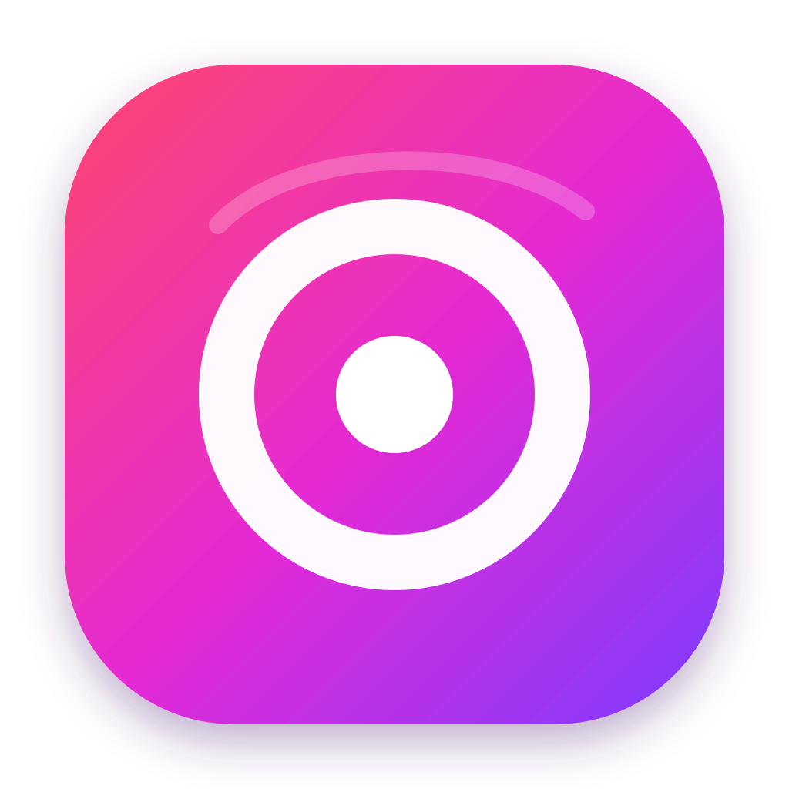
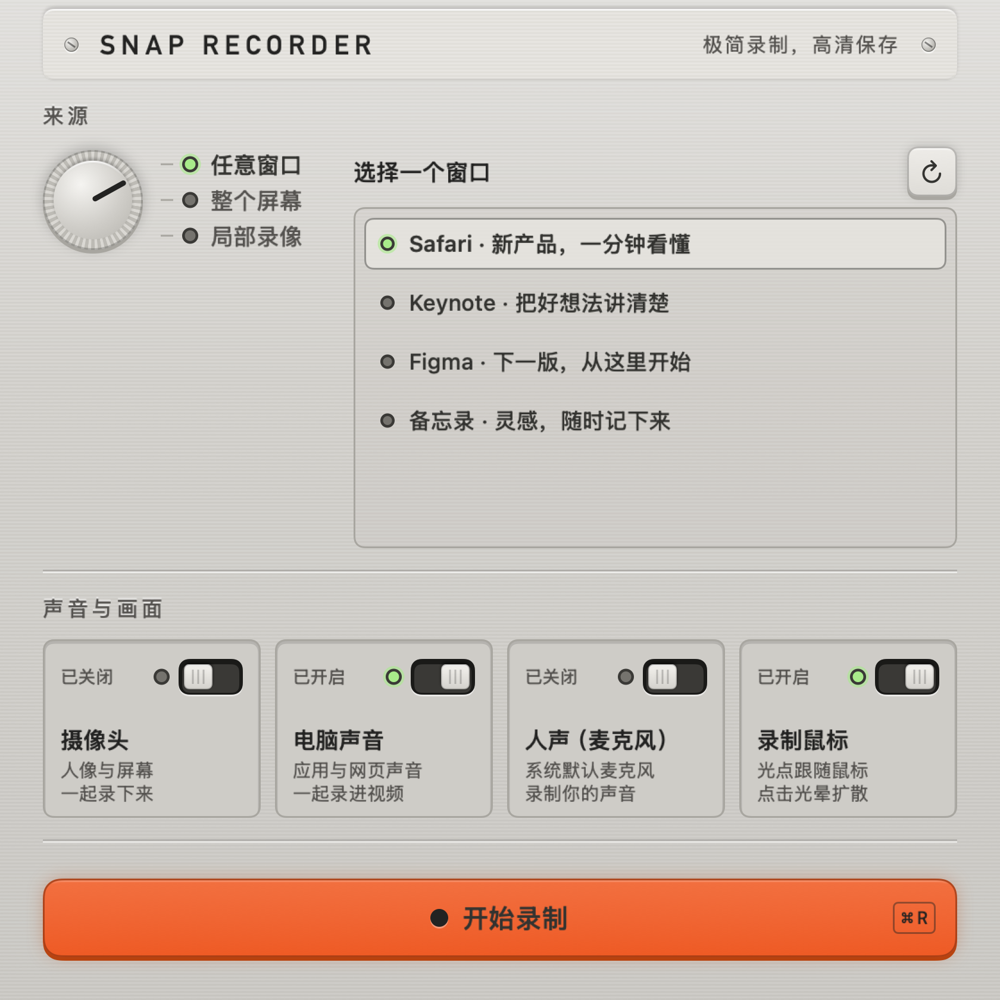
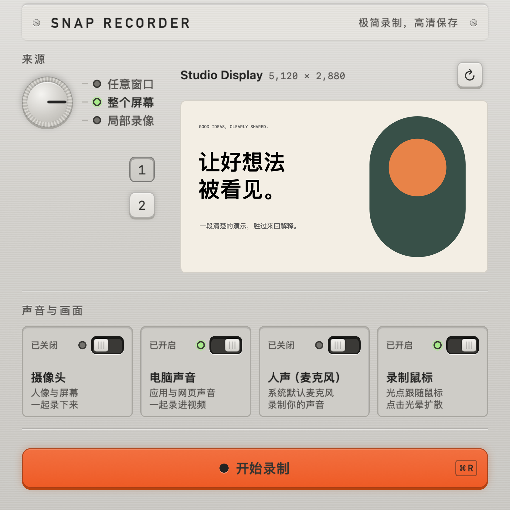
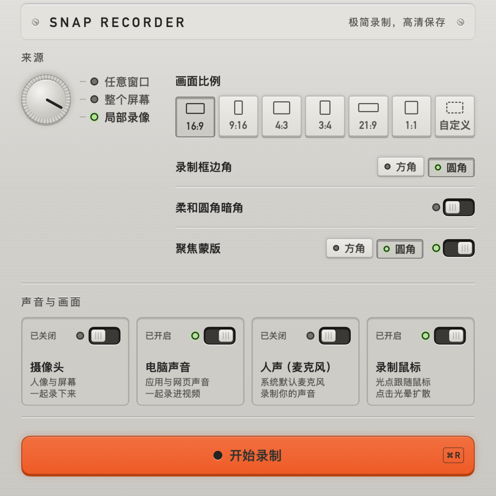
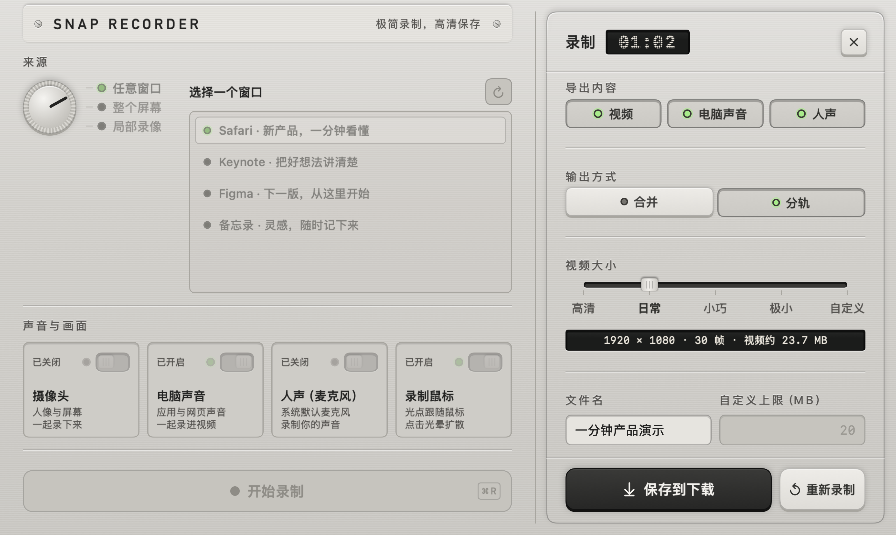
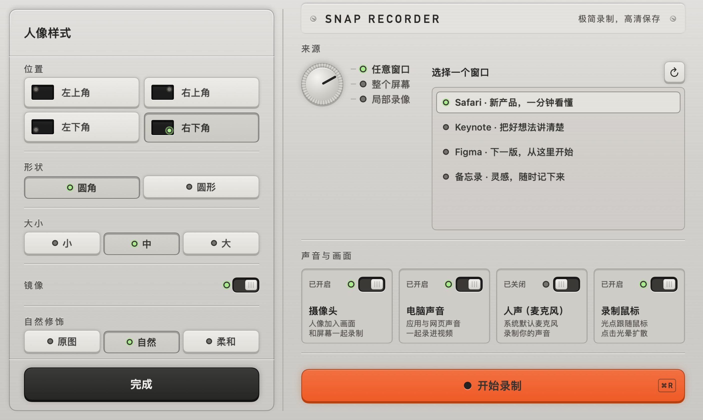

<div align="center">
  
  <h1>Snap Recorder 2.0</h1>
  <p><strong>把想法，录清楚。</strong></p>
  <p>为 Mac 打造的轻巧录屏工具。产品演示、教程讲解、灵感记录，打开就能录。</p>
  <p>
    <a href="https://github.com/shuyan-5200/snap-recorder/releases/download/v2.0.0/Snap-Recorder-v2.0.0-macOS-universal.zip"><strong>下载 Mac 版 ↓</strong></a>
    &nbsp; · &nbsp;
    <a href="https://shuyan-5200.github.io/snap-recorder/">看看它能做什么</a>
    &nbsp; · &nbsp;
    <a href="https://github.com/shuyan-5200/snap-recorder/releases/tag/v2.0.0">2.0 更新</a>
  </p>
  <p><sub>macOS 14+ · Apple Silicon / Intel · 免费开源 · 无需账号</sub></p>
</div>

<p align="center">
  <a href="docs/images/v2.0/main.png"></a>
  <br><sub>有质感的器物界面，一颗橙色录制键。原生界面使用演示内容，点击可看原图。</sub>
</p>

## 想录哪，就录哪

**一个窗口，一块屏幕，或你框出的那一部分。** 窗口录制不带入桌面杂物，多屏演示可以指定屏幕，局部录像支持横屏、竖屏与自由比例。

<table>
  <tr>
    <td width="50%"><a href="docs/images/v2.0/display.png"></a></td>
    <td width="50%"><a href="docs/images/v2.0/region.png"></a></td>
  </tr>
  <tr><td align="center"><strong>多屏切换，一眼选对。</strong></td><td align="center"><strong>框住重点，让画面更专注。</strong></td></tr>
</table>

## 一次录制，多种交付

**带讲解的演示视频、单独的人声、轻巧的分享版，都从同一次录制导出。**

- **声音自由组合**：视频、电脑声音、人声，合并或分轨，也能只导出音频。
- **清晰与体积，自由选择**：高清 / 日常 / 小巧 / 极小，或直接填写视频 MB 上限。
- **不用重录**：保存后换个大小、文件名或声音组合，再导出一份；已有文件不会被覆盖。

[](docs/images/v2.0/export.png)

## 让讲解，更有表现力

**把自己放进画面，把观众的注意力留在重点上。** 摄像头画中画支持位置、形状、大小与自然修饰；鼠标准星、点击波纹和局部聚焦，让每一步操作更清楚。

[](docs/images/v2.0/portrait.png)

## 轻巧，也安心

**不用登录，不用上传。** 屏幕、人像和声音全在本机处理，文件直接存到 Mac 的「下载」。人声与摄像头按需开启，录制中随时暂停、继续或结束。

**选来源 → 录制 → 命名保存。** 没录满意，直接重来；没保存的内容，关闭前会提醒。

## 开始使用

1. [下载 Snap Recorder 2.0](https://github.com/shuyan-5200/snap-recorder/releases/download/v2.0.0/Snap-Recorder-v2.0.0-macOS-universal.zip)，解压并拖入「应用程序」。
2. 首次使用允许屏幕录制；需要讲解或人像时，再开启麦克风与摄像头。
3. 选好来源，点击橙色录制键。

支持 **macOS 14+**，**人声录制需 macOS 15+**。兼容 Apple Silicon 与 Intel。应用尚未经过 Apple 公证；首次启动若被拦截，可在「系统设置 → 隐私与安全性」中允许打开。

[产品说明](docs/product-spec.md) · [隐私说明](PRIVACY.md) · [历史版本](https://github.com/shuyan-5200/snap-recorder/releases) · [更新记录](CHANGELOG.md)

<details>
<summary>开发与构建</summary>

```bash
git clone https://github.com/shuyan-5200/snap-recorder.git
cd snap-recorder
./scripts/build-app.sh
```

构建结果为 `build/Snap Recorder.app`。无需完整 Xcode，无第三方库。

```bash
swift build -c release
.build/release/SnapRecorder --self-test
```

[技术说明](docs/technical-notes.md) · [验证记录](docs/verification.md) · [视觉规范](视觉规范/器物/) · [贡献指南](CONTRIBUTING.md)

</details>

MIT 开源。感谢 [kennanzhou](https://github.com/kennanzhou) 持续贡献录制、交互、多屏与导出体验。
